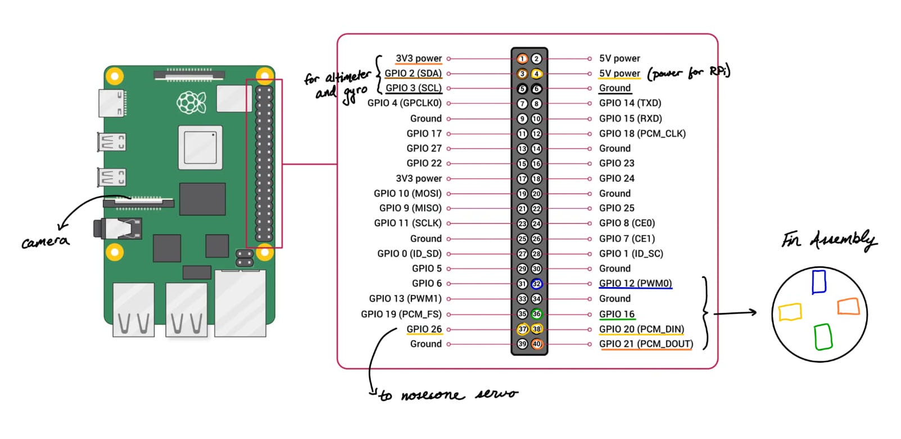

# Fin Controlled Rocket
This repo contains all the files to replicate my fin controlled rocket. It includes 3D CAD files and the code, along with some pictures.

This model rocket is made from off-the-shelf parts. All mechanical/aerodynamic components are 3D printed, with the exception being the fuselage, which is a 30.25" length, 3" diameter cardboard mailing tube. The avionics consist of a Raspberry Pi 4B, an MPU-6050 3-Axis Gyroscope/Accelerometer module, a BME280 barometric pressure and temperature sensor (for altitude measurements), and a generic 8 MP Raspberry Pi camera. There are four MG90D servo motors which actuate the fins. Also, currently (subject to change for future iterations) is another identical servo that is responsible for opening/closing the mechanical hatch on the nosecone to release the parachute. The system is powered by two small 10 Ah easy-to-acquire portable chargers, one which powers the Raspberry Pi and sensors, and other which is responsible for the servo motors.

## Pinout

## Algorithm
The flight code is in the `flight` folder. `flight.py` is the program that runs on the Pi and `helpers.py` has the vector math it uses. The loop runs 50 times a second, and each time it reads the gyro and accelerometer, works out how far the rocket has tipped over, and moves the fins to push it back upright. The barometer is slower so it only gets read every 5th loop.

To run it, from inside the `flight` folder:

    python flight.py          # real flight
    python flight.py bench    # bench test, no launch needed

### Launch pad
When the program starts the rocket has to sit still for about 3 seconds. During that time it averages the gyro readings to find the gyro's bias (the small rate it reports even when nothing is moving), and averages the accelerometer to find which way is up, since at rest the only thing the accelerometer feels is gravity. It also averages the barometer to get the altitude of the pad. This keeps updating for as long as the rocket sits there, so it doesn't matter how long it waits before launch.

Launch is detected when the accelerometer reads more than 3 g for 5 loops in a row. A single spike from bumping the rocket won't set it off.

### Knowing which way is up
Once the motor is burning the accelerometer can't tell me where up is anymore, so from launch onwards I only use the gyro. The program keeps a vector that points "up" as seen from the rocket. Every loop the gyro says how much the rocket rotated, and the up vector gets rotated by the same amount in the opposite direction. The angle between that vector and the nose is the tilt, and its sideways components say which direction the rocket is leaning.

Speed is estimated by adding up the acceleration along the nose and subtracting gravity. It isn't very accurate but it only needs to be roughly right, as explained below.

### Moving the fins
The fins don't move for the first 0.3 seconds so the rocket can clear the launch rail. After that, pitch and yaw each get their own correction:

    fin angle = (KP * tilt - KD * rotation rate) * (V_REF / speed)^2

The first part pushes the rocket back toward vertical, harder the more it's tilted. The second part resists rotation, which stops it from overshooting and wobbling back and forth. The last part is there because the force on a fin grows with the square of the speed. The same fin angle that barely does anything at 20 m/s is far too much at 80 m/s, so the faster the rocket goes the less the fins move. Below 20 m/s the scaling stops growing so the fins don't go to full deflection at low speed.

Roll works the same way, except instead of holding the rocket vertical it holds the roll angle it had at launch, which keeps it from spinning.

The blue and green fins take care of pitch, the orange and yellow fins take care of yaw, and the roll correction is added to all four. No fin is ever turned more than 10 degrees.

### Parachute
The program keeps track of the highest altitude it has seen. Once the rocket is 3 m below that, it's past apogee, and the nosecone servo opens the hatch to release the parachute. This can't happen in the first 3 seconds of flight, in case the barometer reads something odd during the burn. As a backup the nosecone opens 13 seconds after launch no matter what, which should be changed to a few seconds after the expected apogee for whatever motor is being used.

After that the fins go back to centre and the program keeps logging for 2 more minutes, then stops.

### Bench test and logs
In bench mode there is no launch detection and the parachute never deploys. After the 3 second calibration the fins respond straight away, so the the rocket can be held nose up, tilt it by hand and check that each fin moves the right way. If one moves backwards, flip its sign in `FIN_SIGN` at the top of `flight.py`. That's also where the gains, pins and timings are.

Every run saves a CSV in `flight/logs` with the time, phase, tilt, rotation rates, speed, altitude and all four fin angles.
